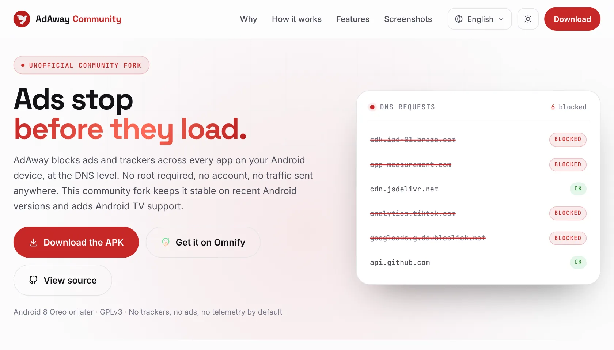

#  AdAway Community

**Ads stop before they load.**

<a href="https://victor-root.github.io/AdAway-Community/"><picture><source media="(prefers-color-scheme: dark)" srcset=".github/assets/website-hero-dark.webp"></picture></a>

**[victor-root.github.io/AdAway-Community](https://victor-root.github.io/AdAway-Community/)** has the download links, the
features and real screenshots, in light and dark, in 63 languages.

AdAway Community is an unofficial fork of [AdAway](https://github.com/AdAway/AdAway), an open source ad blocker for Android. It blocks ads and trackers across every app at the DNS level, with a local VPN (no root) or a root-written hosts file. No account, no telemetry, nothing sent anywhere.

This fork is **not affiliated with, endorsed by, or signed by** the official AdAway maintainers.

---

<strong>📱 Mobile</strong>

  

<strong>📺 Android TV</strong>

  

---

## 📥 Download and updates

  &nbsp;&nbsp;&nbsp;&nbsp;&nbsp;

---

## 🚀 Why this fork exists

AdAway is a great project, but its updates had slowed down and some useful fixes were left waiting, including work on VPN-mode stability on recent Android versions and OEM ROMs. This fork keeps them alive in a build you can actually install, and keeps Android TV in the same app.

This is not a hostile fork and not a claim of ownership over the original project. If the official project becomes actively maintained again and equivalent fixes land there, this fork may be archived or re-aligned with upstream.

### Version 7: rebuilt from scratch

AdAway relied on very old code and tools. Patching them any longer was not an option if the app was to stay stable, fast, secure and easy to maintain, so everything was rebuilt on modern foundations: **Kotlin** for the app, **Rust** for the blocking engine, and no C code left. It was a big job, but an unavoidable one.

For users, nothing changes: same screens, same settings, and the sources, lists and settings of a 6.x install are imported on the first launch. Behind the scenes, everything is new.

---

## 🛡️ How it works

Ads and trackers must look up a domain name before they can load. AdAway answers those lookups with nothing, so the request never leaves your device, in every app.

| | VPN mode | Root mode |
|:--|:--|:--|
| **Needs** | no root | a rooted device |
| **How** | a local VPN that only intercepts DNS requests; blocked names get an empty answer, the others go to the upstream DNS server | the blocklist is written into the system hosts file; a small local web server answers the blocked hosts at once |
| **Upstream DNS** | system, custom servers, or DNS over HTTPS | not used |
| **DNS log** | yes, from the tunnel | yes, from a root DNS capture |

---

## ✨ Features

- 🛡️ **Stable VPN mode:** the app, the notification and the Quick Settings tile always agree, and the VPN comes back on its own if your phone kills it;
- 📺 **Android TV:** a full interface built for a remote, on TVs and TV boxes;
- 📊 **Live DNS log:** see what each app asks for, then block, allow or redirect it in one tap;
- 📝 **Your own lists:** blocked, allowed and redirected hosts, searchable, with wildcards, and per-app VPN exclusions;
- 🌐 **DNS servers:** choose the upstream servers of the VPN, including DNS over HTTPS;
- 🔄 **Sources:** community hosts files, refreshed automatically, with your own sources and local files;
- 💾 **Backup and restore** of your sources and rules, in the format of the 6.x versions so that old backups restore too;
- 🔁 **Built-in updater** that follows this repository's releases, plus a diagnostic log you can record, copy and share to report a VPN problem.

---

## 🧱 Under the hood

The repository holds the Android app and a Rust workspace:

| Part | What it does |
|:--|:--|
| `app/` | The Kotlin app: Jetpack Compose interface (phone, tablet and a separate TV interface), Room database for sources and your rules, DataStore for settings, WorkManager for the automatic updates, libsu for root |
| `rust/engine` | The blocking engine: reads and cleans the sources, computes the final lists, filters DNS queries, runs the VPN tunnel and records the DNS log |
| `rust/doh` | The DNS over HTTPS relay the tunnel sends its queries to, as to a plain DNS server |
| `rust/root` | The processes started as root: the local web server for blocked hosts and the DNS capture |
| `rust/android` | The JNI bindings that expose the engine to the app |

How the final list is computed:

- your own rules always win over the sources;
- within each of the two layers, a redirection wins over an allow rule, which wins over a block rule;
- block and redirect rules from sources match exact names only, while allow rules and your own block rules may use wildcards;
- the result is written as sorted files, which the tunnel and the hosts file writer use.

Building needs Android Studio, the Android NDK and Rust: see [BUILDING.md](BUILDING.md) (in French). The Rust engine has its own tests (`cargo test` in `rust/`), and the app has unit tests (`gradlew testDebugUnitTest`). The architecture and the behavior of the app are specified in [docs/cahier-des-charges](docs/cahier-des-charges/README.md) (in French).

---

## 📺 Android TV

The TV interface is written for this fork and lives in the same app as the phone one: Leanback launcher entry, TV banner, a D-pad friendly home screen, lists, sources, DNS log and setup wizard.

Feedback from more TV devices is welcome, especially for different remotes, launchers, boxes and the VPN permission flow on different Android TV builds.

---

## 🧪 Feedback and contributing

Feedback is welcome, especially for VPN-mode stability, Android TV behavior and recent Android/OEM compatibility. The [issue forms](https://github.com/Victor-root/AdAway-Community/issues/new/choose) ask for what is needed to reproduce a problem, and [CONTRIBUTING.md](CONTRIBUTING.md) explains how to report it and how to send a change.

---

## 🌍 Translations

The app speaks **65 languages** 🗣️, entirely thanks to the community of volunteer translators. 💜

Spotted a missing string or an awkward wording? Contributions to start a new language or improve an existing one are always welcome, through a pull request: see [TRANSLATING.md](TRANSLATING.md) for where the texts are and how to send them. Every little bit helps! 🙌

---

## 🧱 Requirements

- Android 8 Oreo or above;
- VPN mode (Android VPN permission) or root mode, depending on your setup.

For devices older than Android 8 Oreo, use older official AdAway versions from upstream.

---

## 🔐 Permissions

- `INTERNET` to download hosts files and application updates;
- `ACCESS_NETWORK_STATE` to monitor network changes;
- `RECEIVE_BOOT_COMPLETED` to optionally start AdAway after boot;
- `FOREGROUND_SERVICE` to run the VPN service in foreground;
- `POST_NOTIFICATIONS` for source update, app update and VPN control notifications;
- `REQUEST_IGNORE_BATTERY_OPTIMIZATIONS` to keep the VPN alive against battery managers;
- `REQUEST_INSTALL_PACKAGES` and `UPDATE_PACKAGES_WITHOUT_USER_ACTION` for the built-in updater;
- `QUERY_ALL_PACKAGES` to let users exclude apps from VPN.

---

## 🤝 Credits

AdAway was created and maintained by the official AdAway project contributors.

Official project:
https://github.com/AdAway/AdAway | Official website: https://adaway.org

Thanks to the original author, past maintainers, current maintainers, translators, hosts list maintainers and all contributors who made AdAway possible.

---

## ⚖️ License

AdAway Community is licensed under the GPLv3+, the same license as the original AdAway project.

When distributing APK builds, the corresponding source code is made available through this repository and its release tags/commits.

See [LICENSE.md](LICENSE.md) for the full license text, and [THIRD_PARTY_NOTICES.md](THIRD_PARTY_NOTICES.md) for the licenses of the components AdAway is built with.
